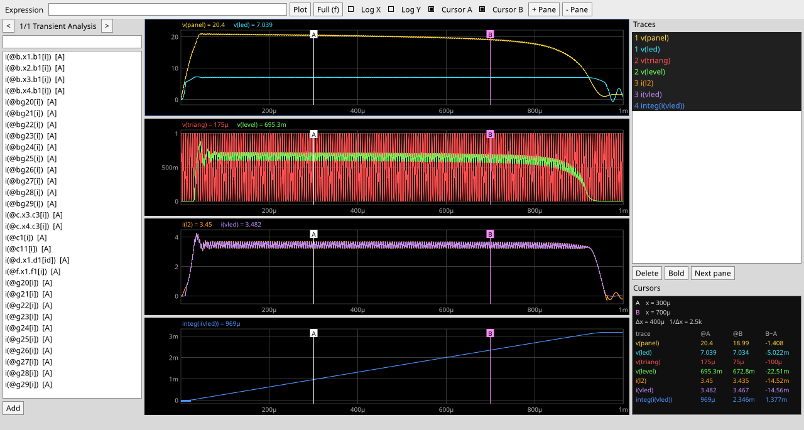

# Schemify

**Schematic capture for analog and mixed-signal IC design: a fast, lightweight replacement for
[xschem](https://xschem.sourceforge.io/), written in Rust.**

[](https://github.com/OmarSiwy/Schemify/actions/workflows/ci.yml)
[](https://github.com/OmarSiwy/Schemify/actions/workflows/nightly.yml)
[](https://github.com/OmarSiwy/Schemify/actions/workflows/mutants.yml)
[](https://github.com/OmarSiwy/Schemify/actions/workflows/release.yml)
[](#license)
[](Cargo.toml)

Schemify draws schematics, writes netlists for ngspice, Xyce, CDL, Spectre and Verilog, runs
simulations and shows the waveforms. It opens existing xschem libraries and PDKs, so you can
switch without redrawing anything. Every cell can carry a documentation page with LaTeX and live
sizing math (gm/Id) that updates the schematic when a parameter changes. The same code runs on
Linux, macOS, Windows and in a browser.


## Why Schemify

- **Diffs and merges cleanly.** Design files are plain text, one line per object, sorted by a
  stable id. Moving a part or changing a parameter changes one line. `schemify merge-driver`
  merges branches by object rather than by text line.
- **Opening a file never runs anything.** Designs are pure data. Simulator commands live in your
  config and in plugins, never in a file you received.
- **Small core, everything else is a plugin.** Like Neovim: a headless `schemify` binary
  (netlist, check, run, import) and a separate editor. The xschem-style menus and toolbar are
  themselves a WASM plugin you can replace. Plugins run sandboxed with the permissions you grant.
- **Documentation next to the circuit.** A `.shcomp` holds the symbol, the schematic and a docs
  page: Markdown, LaTeX math, variables and plots that recompute when a value changes.
- **Same output everywhere.** Netlists are byte-identical on Linux, macOS, Windows and WASI;
  CI compares them on every push.
- **Keeps your muscle memory.** The default keys are xschem's; `/` shows them all.

## Screenshots

| | |
|---|---|
|  |  |
| Editing a hierarchical cell | Simulate: results table, specs, waveforms, plot on the docs page |
|  |  |
| A SPICE netlist turned into a schematic (`cktimg` plugin) | The waveform viewer |

## Quick start

With Nix (flakes), no checkout needed:

```sh
nix run github:OmarSiwy/Schemify -- path/to/cell.shcomp     # the editor
```

From source (Rust 1.95 or newer; on Linux the editor needs the Wayland or X11 and Vulkan
libraries at runtime; `nix develop` provides everything, including ngspice and xschem):

```sh
git clone https://github.com/OmarSiwy/Schemify && cd Schemify
cargo run --release -p schemify-app -- crates/app/tests/fixtures/ota/ota.shcomp      # editor
cargo run --release -p schemify-cli -- netlist crates/app/tests/fixtures/rc/tb.shbench
cargo run --release -p schemify-cli -- run crates/app/tests/fixtures/rc/tb.shbench   # needs ngspice
```

Bring an existing xschem library or PDK across:

```sh
schemify import ~/xschem/my_lib -o my_lib
```

## The command line

`schemify` is the headless core. Exit codes: 0 success, 1 design errors, 2 usage or I/O errors.

| Command | What it does |
|---|---|
| `schemify edit [<dir>\|<cell>]` | open the editor (starts `schemify-gui`) |
| `schemify netlist <cell> [--dialect D]` | write a netlist: `ngspice`, `xyce`, `cdl`, `spectre`, `verilog` |
| `schemify check <cell>` | report violations (dangling pins, shorted labels, parameter ranges, …) |
| `schemify run <bench> [--sweep S] [--mc M] [--corner K]` | simulate a `.shbench` and print its outputs and specs |
| `schemify import <xschem-dir>… -o <dir>` | convert xschem designs and PDK device libraries |
| `schemify fmt [--check] <file>…` | rewrite files in canonical form |
| `schemify diff <A> <B>` | object-level diff of two design files |
| `schemify git-setup` | register the merge driver in this clone |
| `schemify pack sync\|update\|restore\|clean\|status` | manage the plugins listed in your config |

`schemify --help` lists every flag.

## File kinds

| Kind | Holds | Example use |
|---|---|---|
| `.shprim` | a symbol and its device definition (SPICE, Verilog-A or Verilog) | a PDK transistor |
| `.shcomp` | a symbol, its schematic and a docs page | an OTA, an inverter |
| `.shbench` | a schematic, a docs page, simulation setup (corners, sweeps, specs) and SPICE code | a testbench; the only kind you can run |

A design file is readable on its own:

```
schemify 1 shcomp
  doc "Two-inverter buffer: an inverter cell used as a hierarchical sub-cell"

pin IN in -40 0
pin OUT out 40 0

impl sch schematic

inst x00001 ./inv
  at 0 0 R0
  name x1

wire w00001 40 0 100 0
```

The full format is in [docs/spec/format.md](docs/spec/format.md).

## Configuration and plugins

Your config is Lua, in the same places Neovim uses:

| OS | Config (`init.lua`) | Installed plugins |
|---|---|---|
| Linux, macOS | `~/.config/schemify` (`$XDG_CONFIG_HOME`) | `~/.local/share/schemify` (`$XDG_DATA_HOME`) |
| Windows | `%LOCALAPPDATA%\schemify` | `%LOCALAPPDATA%\schemify-data` |

```lua
schemify.opt.grid = 20
schemify.keymap.set("F5", function() schemify.cmd("sim.simulate") end)
schemify.sim("ngspice", { path = "ngspice", args = { "-b", "-r", "{raw}", "{netlist}" } })

schemify.pack.add {
  { src = "https://github.com/someone/schemify-gmid-lut.git", version = "v1.2.0",
    grant = { "read_project", "spawn:ngspice" } },
}
```

`schemify pack sync` installs the listed plugins and pins them in `schemify-pack.lock` next to
`init.lua`, so the setup can live in your dotfiles. There is no central registry: a plugin is a
git repository or a URL with a sha256. `--clean` starts without your config. The full API is in
[docs/spec/config.md](docs/spec/config.md), with an example in
[docs/examples/init.lua](docs/examples/init.lua).

Plugins are WASM modules ([plugin ABI](docs/spec/plugin-abi.md)). Bundled and example plugins live
in [plugins/](plugins/):

| Plugin | What it adds |
|---|---|
| `default-ui` | the xschem-style menus, toolbar, dialogs and keys (embedded in the editor) |
| `gmid-lut` | gm/Id sizing functions for docs pages, from ngspice-characterized lookup tables |
| `cktimg` | SPICE netlist → placed and routed schematic, via [cktImg](https://github.com/OmarSiwy/cktImg) |

## Status

Pre-release: the features above work end to end; expect rough edges. Progress is tracked in [docs/STATUS.md](docs/STATUS.md)
and [docs/BACKLOG.md](docs/BACKLOG.md).

| Platform | Built and tested in CI | Netlists byte-identical | Notes |
|---|---|---|---|
| Linux | ✅ | ✅ | |
| macOS | ✅ | ✅ | |
| Windows | ✅ | ✅ | |
| Browser (WASM) | builds, starts in headless Chrome | ✅ (WASI) | drawing needs WebGPU; files persist in the browser (OPFS), projects in/out as zip; Lua config from `/config/init.lua` |

- **xschem compatibility:** netlists of 246 of 301 corpus benches (sky130, GF180, IHP and xschem's
  examples) are equivalent to xschem's SPICE output, and 227 of 301 for CDL (comparing without
  the benches' inline code blocks). Every remaining
  difference is triaged in [tests/corpus/RATCHET.md](tests/corpus/RATCHET.md); the nightly run
  fails if the count drops.
- **Testing:** about 620 tests on every push, plus nightly fuzzing of the parsers, a performance
  regression gate and a weekly mutation-testing run ([TESTING.md](TESTING.md)).
- **Size:** the core is 2.6 MB and the editor 16 MB (stripped); the targets are 2 MB and 10 MB
  ([docs/perf.md](docs/perf.md)).

## Documentation

- [ARCHITECTURE.md](ARCHITECTURE.md): crates, data ownership, pipelines.
- [docs/DECISIONS.md](docs/DECISIONS.md): the settled design decisions and why.
- [docs/spec/](docs/spec/): file format, expression language, netlisting, config, plugin ABI.
- [TESTING.md](TESTING.md): the test plan and the CI tiers.

## Contributing

Read [AGENTS.md](AGENTS.md) first; it applies to people and AI agents alike. The one rule that is
easy to break by accident: **Schemify is a clean-room implementation.** Do not open, copy or port
xschem's source (or any GPL code). Behaviour is matched by running xschem and comparing outputs.

## License

Licensed under either of [MIT](LICENSE-MIT) or [Apache-2.0](LICENSE-APACHE) at your option.
