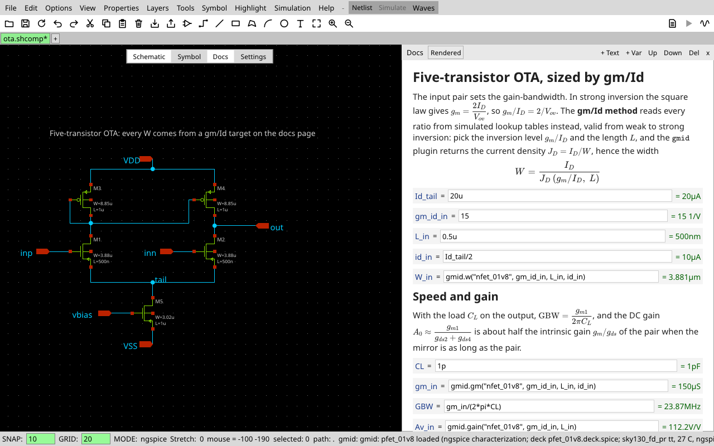
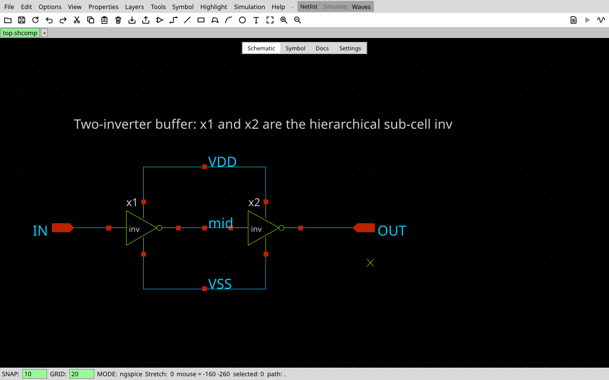
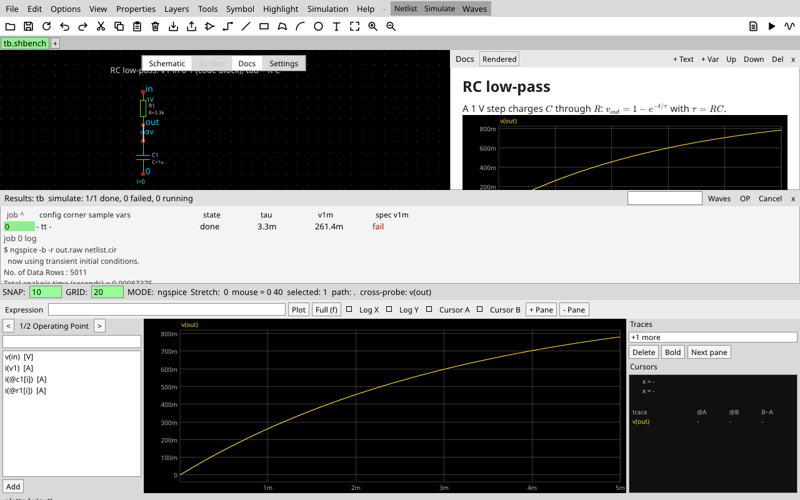
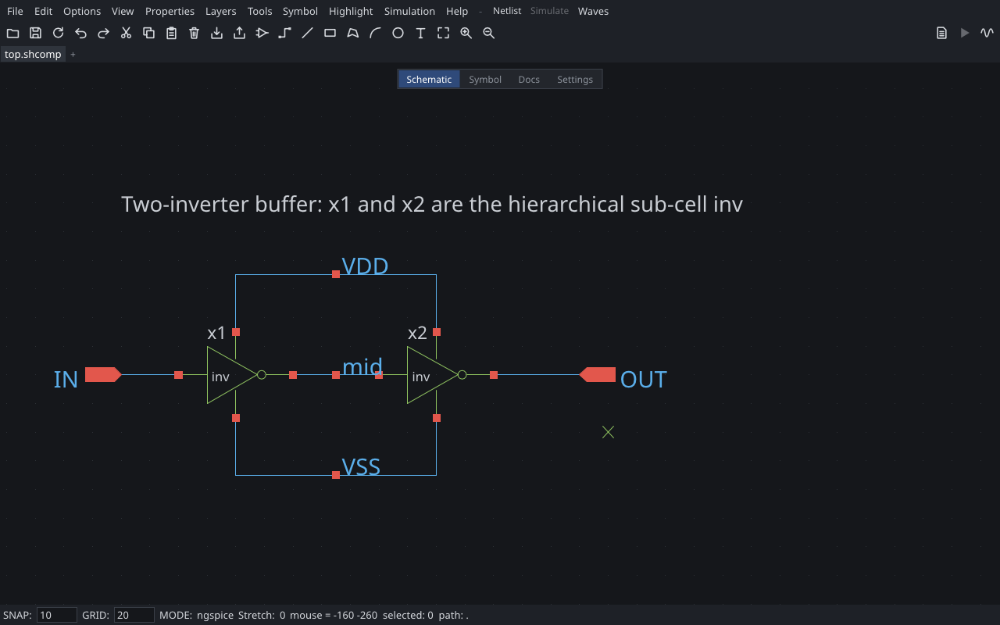

# Schemify

**Schematic capture for analog and mixed-signal IC design: a fast, lightweight replacement for
[xschem](https://xschem.sourceforge.io/), written in Rust.**

[](https://github.com/OmarSiwy/Schemify/actions/workflows/ci.yml)
[](https://github.com/OmarSiwy/Schemify/actions/workflows/nightly.yml)
[](LICENSE)
[](Cargo.toml)

Schemify draws schematics, writes netlists for ngspice, Xyce, CDL, Spectre and Verilog, runs
simulations and shows the waveforms. It imports xschem libraries and PDKs, so you can switch
without redrawing anything. Every cell can carry a documentation page with LaTeX and live
sizing math (gm/Id) that updates the schematic when a parameter changes. The same code runs on
Linux, macOS, Windows and in a browser.



## Why Schemify

- Design files are plain text, one line per object, sorted by a stable id. Moving a part or
  changing a parameter changes one line, and `schemify merge-driver` merges branches object by
  object instead of line by line.
- Opening a file never runs anything. Designs are pure data; simulator commands live in your own
  config and in plugins, never in a file someone sent you.
- The core is small and the rest is plugins, as in Neovim. `schemify` is a headless binary
  (netlist, check, run) and the editor is separate. The xschem-style menus, toolbar and keys are
  themselves a wasm plugin you can replace. Plugins run sandboxed with the permissions you grant.
- Documentation sits next to the circuit. A `.shcomp` holds the symbol, the schematic and a docs
  page with Markdown, LaTeX math, variables and plots that recompute when a value changes.
- Netlists are byte-identical on Linux, macOS, Windows and WASI, and CI compares them on every
  push.
- The default keys are xschem's, so your muscle memory still works.

## Screenshots

| | |
|---|---|
|  |  |
| Editing a hierarchical cell | After a simulation: results, specs and waveforms |
|  |  |
| A SPICE netlist turned into a schematic (`cktimg` plugin) | The optional Modern theme (View menu) |

## Quick start

With Nix (flakes), no checkout needed:

```sh
nix run github:OmarSiwy/Schemify -- path/to/cell.shcomp
```

From source, with Rust 1.95 or newer. On Linux the editor needs the Wayland or X11 and Vulkan
libraries at runtime; `nix develop` provides them along with ngspice and xschem.

```sh
git clone --recurse-submodules https://github.com/OmarSiwy/Schemify && cd Schemify
cargo run --release -p schemify-app -- crates/app/tests/fixtures/ota/ota.shcomp      # the editor
cargo run --release -p schemify-cli -- netlist crates/app/tests/fixtures/rc/tb.shbench
cargo run --release -p schemify-cli -- run crates/app/tests/fixtures/rc/tb.shbench   # needs ngspice
```

To bring an xschem library across, use the `interop` plugin's command line (`schemify-interop`,
or `nix run .#interop --`):

```sh
schemify-interop xschem-import ~/xschem/my_lib -o my_lib
```

[docs/guide/install.md](docs/guide/install.md) covers installation in detail, and
[docs/guide/tutorial.md](docs/guide/tutorial.md) walks through a first session.

## A design file

```
schemify 1 shcomp
  doc "Two-inverter buffer: an inverter cell used as a hierarchical sub-cell"

pin IN in -40 0
pin OUT out 40 0

impl sch schematic

inst x00001 ./inv
  at 0 0 R0
  name x1

wire w00001 40 0 100 0
```

There are three kinds of file:

| Kind | Holds | Example |
|---|---|---|
| `.shprim` | a symbol and its device definition (SPICE, Verilog-A or Verilog) | a PDK transistor |
| `.shcomp` | a symbol, its schematic and a docs page | an OTA, an inverter |
| `.shbench` | a schematic, a docs page, the simulation setup (corners, sweeps, specs) and SPICE code | a testbench, the only kind you can run |

## The command line

`schemify` is the headless core. It exits with 0 on success, 1 on design errors and 2 on usage or
I/O errors.

| Command | What it does |
|---|---|
| `schemify edit [<dir>\|<cell>]` | open the editor (starts `schemify-gui`) |
| `schemify netlist <cell> [--dialect D]` | write a netlist: `ngspice`, `xyce`, `cdl`, `spectre`, `verilog`, `espice` |
| `schemify check <cell>` | report violations (dangling pins, shorted labels, parameter ranges, ...) |
| `schemify run <bench> [--sweep S] [--mc M] [--corner K]` | simulate a `.shbench` and print its outputs and specs |
| `schemify fmt [--check] <file>...` | rewrite files in canonical form |
| `schemify diff <A> <B>` | object-level diff of two design files |
| `schemify git-setup` | register the merge driver in this clone |
| `schemify pack sync\|update\|restore\|clean\|status` | manage the plugins listed in your config |

The full reference is [docs/guide/cli.md](docs/guide/cli.md).

## Configuration and plugins

Your config is a Lua file, `init.lua`, in the same places Neovim uses (`~/.config/schemify` on
Linux and macOS, `%LOCALAPPDATA%\schemify` on Windows):

```lua
schemify.opt.grid = 20
schemify.keymap.set("F5", function() schemify.cmd("sim.simulate") end)
schemify.sim("ngspice", { path = "ngspice", args = { "-b", "-r", "{raw}", "{netlist}" } })

schemify.pack.add {
  { src = "https://github.com/someone/schemify-gmid-lut.git", version = "v1.2.0",
    grant = { "read_project", "spawn:ngspice" } },
}
```

`schemify pack sync` installs the listed plugins and pins them in `schemify-pack.lock` next to
`init.lua`, so the setup can live in your dotfiles. There is no central registry: a plugin is a
git repository, or a URL with a sha256. See [docs/guide/config.md](docs/guide/config.md).

Plugins are wasm modules ([plugin ABI](docs/spec/plugin-abi.md)). The ones in this repository:

| Plugin | What it adds |
|---|---|
| [`interop`](plugins/interop) | xschem libraries and PDK device libraries into Schemify, and Virtuoso import and export (native CLI `schemify-interop`) |
| [`pdk-manager`](plugins/pdk-manager) | installs an open PDK (sky130, GF180, IHP and others) into a project |
| [`gmid-lut`](plugins/gmid-lut) | gm/Id sizing functions for docs pages, from ngspice-characterized lookup tables |
| [`cktimg`](plugins/cktimg) | SPICE netlist to placed and routed schematic, via [cktImg](https://github.com/OmarSiwy/cktImg) |

The default UI (menus, toolbar, dialogs and keys) is a plugin too, in
[ui/default-plugin](ui/default-plugin), and is built into the editor.

## Status

Pre-release. The features above work end to end, but expect rough edges.

| Platform | Built and tested in CI | Netlists byte-identical |
|---|---|---|
| Linux | yes | yes |
| macOS | yes | yes |
| Windows | yes | yes |
| Browser (wasm) | builds and starts in headless Chrome | yes (WASI) |

The browser build draws with WebGPU, with a CPU fallback. Files persist in the browser's storage
and projects move in and out as zip files ([docs/guide/web.md](docs/guide/web.md)).

Against xschem, the netlists of 255 of 301 corpus benches (sky130, GF180, IHP and xschem's
examples) are equivalent to xschem's SPICE output, and 235 of 301 for CDL. Every remaining
difference is triaged in [tests/corpus/RATCHET.md](tests/corpus/RATCHET.md), and the nightly run
fails if the count drops.

## Documentation

[docs/](docs/README.md) has the user guide, the file format and language specs, and the
contributor notes.

## Contributing

Read [docs/dev/contributing.md](docs/dev/contributing.md) first; it applies to people and AI
agents alike. The rule that is easiest to break by accident: Schemify is a clean-room
implementation. Do not open, copy or port xschem's source, or any GPL code. Behaviour is matched
by running xschem and comparing outputs.

## License

[MIT](LICENSE).
